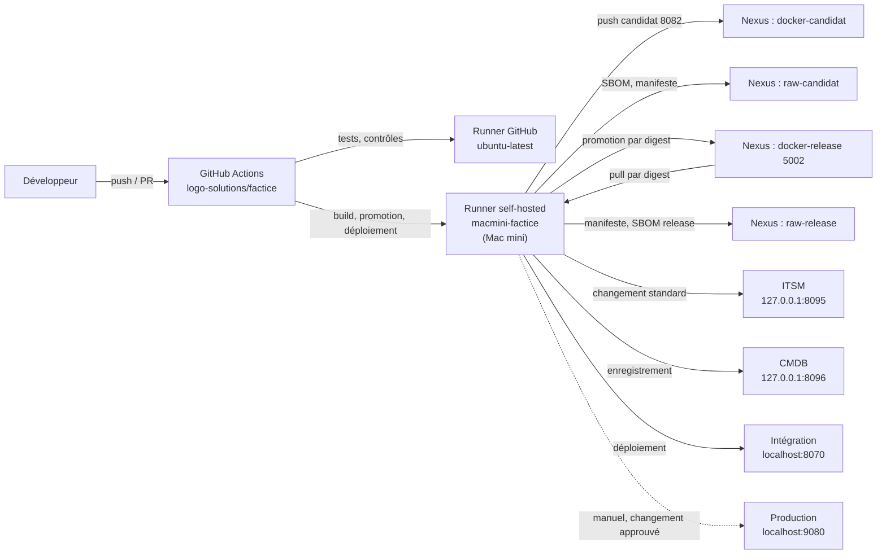
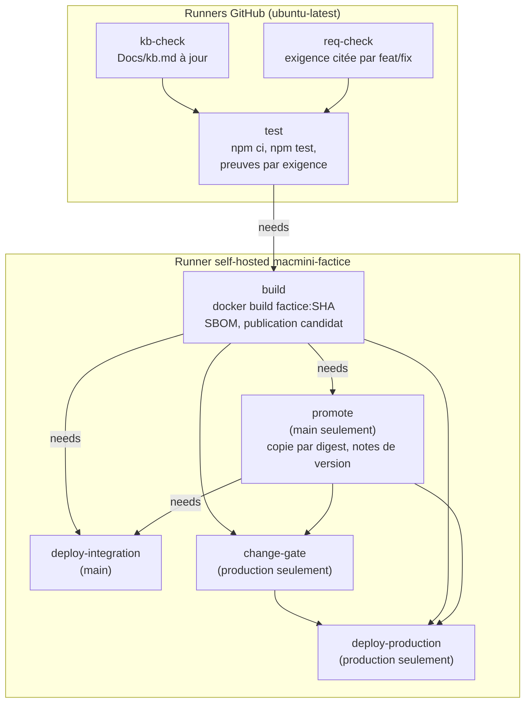

# Graphe du CI factice

Schéma du workflow `.github/workflows/ci.yml` et de ses interactions avec les systèmes externes. État au 2026-10-20 (branche `main`).

## Vue d'ensemble

## Déclencheurs

| Événement | Jobs exécutés |
|---|---|
| `push` sur `main` | kb-check, req-check, test, build, promote, deploy-integration |
| `pull_request` vers `main` | kb-check, req-check, test (pas de build, pas de promotion, pas de déploiement) |
| `workflow_dispatch`, `deploy_env=integration` | comme `main`, déploiement en intégration |
| `workflow_dispatch`, `deploy_env=production` | change-gate, deploy-production (après build et promote) |

## Graphe des jobs

## Détail des étapes

### build (self-hosted, hors PR)
1. `docker build -t factice:<SHA> app`
2. `npm ci` (dépendances pour le scan SBOM)
3. `scripts/nexus/publish-candidate.sh` (identifiants : compte `svc-build-factice-app`, secret `NEXUS_BUILD_PASSWORD`) :
   - login sur `localhost:8082` ;
   - génération du SBOM (`gen-sbom.sh`) ;
   - push de l'image `factice.app/factice:<version>-<build>` dans `docker-candidat` ;
   - dépôt du SBOM et du manifeste dans `raw-candidat`, **le manifeste en dernier** ;
   - en cas d'échec, retrait de ce qui a été envoyé (candidat complet ou absent).

### promote (self-hosted, main seulement)
1. `scripts/nexus/promote.sh` (compte `svc-promotion`, secret `NEXUS_PROMOTION_PASSWORD`) :
   - contrôles bloquants : manifeste et SBOM présents et cohérents (R2), commit sur une branche protégée (R3) ;
   - copie de l'image **par digest** de `docker-candidat` vers `docker-release` (`localhost:5002`), tag de version ;
   - dépôt du manifeste et du SBOM dans `raw-release`.
2. Les sorties `release` et `digest` alimentent les jobs suivants.
3. Notes de version (`scripts/release/notes.sh`) dans le résumé de l'exécution.

### deploy-integration (self-hosted, main)
1. Trace ITSM : création d'un **changement standard pré-approuvé** (`itsm.sh create standard`).
2. Déploiement de l'image par digest depuis `docker-release` (compte `svc-deploiement`, secret `NEXUS_DEPLOY_PASSWORD`), via Ansible.
3. Vérification `curl http://localhost:8070/health`.
4. Événement de déploiement (`deployment-event.sh`) : vers la CMDB, `résultat` = réussi ou échoué.
5. Inventaire CMDB (`cmdb.sh register-service ... integration`), jeton `CMDB_TOKEN`.
6. Clôture ITSM : lien vers le digest et l'exécution, puis `close`.
7. En cas d'échec : ouverture d'un **incident ITSM**.

### production (manuel, workflow_dispatch)
1. **change-gate** : exige un changement **approuvé** dans l'ITSM (`itsm.sh create normal`, puis `require-approved`).
2. **deploy-production** : même schéma que l'intégration, port 9080, vérification `curl http://localhost:9080/health`, puis CMDB et clôture ITSM.

## Systèmes externes

| Système | Adresse | Rôle dans le CI | Identifiant |
|---|---|---|---|
| GitHub Actions | `github.com/logo-solutions/factice` | Orchestration, secrets, environnement `production` | `GITHUB_TOKEN` |
| Runner self-hosted | Mac mini, `macmini-factice` | Exécute build, promote, déploiements | — |
| Nexus `docker-candidat` | `localhost:8082` | Image candidate | `svc-build-factice-app` |
| Nexus `raw-candidat` | `localhost:8081` | SBOM et manifeste candidats | `svc-build-factice-app` |
| Nexus `docker-release` | `localhost:5002` | Image promue (digest) | `svc-promotion`, `svc-deploiement` |
| Nexus `raw-release` | `localhost:8081` | Manifeste et SBOM de la release | `svc-promotion` |
| ITSM | `127.0.0.1:8095` | Changements standard et normaux, incidents | `ITSM_TOKEN` |
| CMDB | `127.0.0.1:8096` | Inventaire, événements de déploiement | `CMDB_TOKEN` |
| Intégration | `localhost:8070` | Environnement de test automatique | — |
| Production | `localhost:9080` | Environnement, déploiement manuel après approbation | — |

## Points de vigilance

- **Digest, pas tag** : la promotion et le déploiement utilisent l'empreinte (`sha256:…`), jamais le tag.
- **Garde-fous** : un échec de promotion doit faire échouer le job (`pipefail`, PR #12). Un candidat incomplet n'est jamais promu.
- **Production** : aucun déploiement automatique ; un changement ITSM approuvé est exigé.
- **Dépendances externes** : ITSM et CMDB sont appelées en `127.0.0.1` depuis le runner. Si l'un des deux est arrêté, la trace ITSM et l'inventaire CMDB échouent.
- **Lien `scripts/cmdb`** : doit pointer vers des fichiers présents dans le dépôt (voir la PR `ci/cmdb-scripts-en-dur`).
